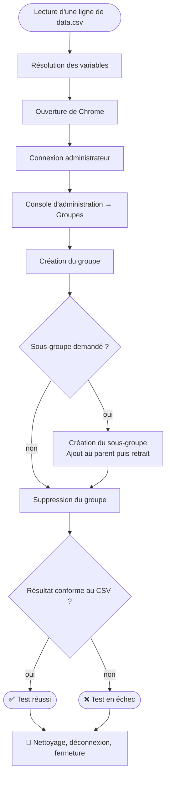
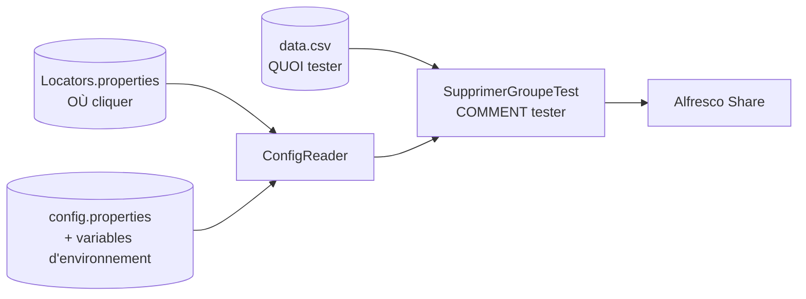

<div align="center">

# 🧪 Alfresco Selenium QA Automation

### Automatisation de tests d'interface pour **Alfresco Share**
*Tests pilotés par les données · Locators externalisés · Secrets protégés*

<br>


</div>

---

## 🎯 À propos

J'ai réalisé ce projet pour automatiser la **gestion des groupes** dans la console d'administration
d'**Alfresco Share**, avec **Selenium WebDriver**, **JUnit 5** et **Maven**.

L'objectif : une automatisation **lisible, maintenable et sûre**. Le code, les données de test et les
sélecteurs sont séparés, l'environnement est nettoyé après chaque test et aucun secret n'est versionné.

> **En résumé :** à partir d'un fichier CSV, les tests créent des groupes et sous-groupes dans Alfresco,
> les manipulent, les suppriment, puis vérifient que l'application accepte ou refuse chaque opération comme prévu.

---

## ✨ Points forts

| | Fonctionnalité | Détail |
|---|---|---|
| 📊 | **Tests pilotés par les données** | Chaque ligne de `data.csv` devient un test JUnit indépendant (`@ParameterizedTest`). |
| 🎯 | **Locators externalisés** | Aucun sélecteur dans le code Java : tout est dans `Locators.properties`. |
| ✅❌ | **Cas nominaux et cas d'erreur** | Un test valide aussi qu'Alfresco **refuse** une opération invalide, à l'étape attendue. |
| 🧹 | **Nettoyage garanti** | Les groupes créés sont supprimés même en cas d'échec (`finally`, ordre inverse de création). |
| 🔁 | **Données uniques** | La variable `${unique}` évite toute collision entre deux exécutions. |
| 🔐 | **Aucun secret dans le dépôt** | Identifiants fournis par variables d'environnement ou fichier local ignoré par Git. |
| 🌐 | **Indépendant de la langue** | Les locators ne dépendent pas de la langue de l'interface. |
| 🧰 | **Driver géré automatiquement** | WebDriverManager télécharge le `chromedriver` adapté à Chrome. |
| 📝 | **Code documenté** | Javadoc sur chaque classe, méthode et constante. |
| 🤖 | **CI et Dependabot** | Compilation vérifiée à chaque *push*, mises à jour de dépendances automatiques. |

---

## 🧩 Scénarios couverts

Les cas sont définis dans [`data.csv`](src/test/resources/data.csv).

| ID | Type | Scénario | Résultat attendu |
|---|:---:|---|---|
| `GRP_N01` | ✅ Nominal | Créer un groupe et un sous-groupe, ajouter puis retirer le sous-groupe, tout supprimer | Le déroulé va au bout |
| `GRP_N02` | ✅ Nominal | Créer puis supprimer un groupe simple | Le déroulé va au bout |
| `GRP_E01` | ❌ Exception | Création avec un identifiant vide | Refus à l'étape `creation-groupe` |
| `GRP_E02` | ❌ Exception | Création d'un groupe déjà existant | Refus à l'étape `creation-groupe` |

### 🔄 Déroulé d'un test



---

## 🏗️ Architecture

```text
alfresco-selenium-qa-automation/
├── pom.xml
├── README.md
├── SECURITY.md
├── .github/
│   ├── workflows/ci.yml
│   └── dependabot.yml
└── src/test/
    ├── java/
    │   ├── config/ConfigReader.java          Configuration, secrets, locators, variables de données
    │   └── tests/SupprimerGroupeTest.java    Scénarios de gestion des groupes
    └── resources/
        ├── config.properties                 Valeurs par défaut (sans secret)
        ├── config.local.properties.example   Modèle de configuration locale
        ├── Locators.properties               Sélecteurs de l'interface
        └── data.csv                          Jeux de données
```



| Élément | Rôle |
|---|---|
| `data.csv` | Données et résultats attendus : un cas s'ajoute sans toucher au code |
| `Locators.properties` | Sélecteurs de l'interface : un seul fichier à corriger si l'interface change |
| `ConfigReader` | Point d'accès unique à la configuration et aux secrets |
| `SupprimerGroupeTest` | Logique du scénario, découpée en méthodes courtes et documentées |

---

## 🛠️ Stack technique

| Outil | Version | Usage |
|---|---|---|
| ☕ Java | 17+ | Langage |
| 🌐 Selenium WebDriver | 4.25.0 | Pilotage du navigateur |
| ✅ JUnit Jupiter | 5.10.2 | Exécution et tests paramétrés (`@CsvFileSource`) |
| 📦 Maven + Surefire | 3.2.5 | Build et exécution |
| 🧰 WebDriverManager | 5.9.2 | Téléchargement automatique du driver Chrome |
| 🤖 GitHub Actions | — | Intégration continue |

---

## 🚀 Démarrage rapide

**Prérequis :** JDK 17+, Maven 3.x, Google Chrome et une instance Alfresco Share de test démarrée.

**1. Identifiants** (par variables d'environnement)

```powershell
# Windows (PowerShell)
$env:ALFRESCO_ADMIN_USER = "utilisateur"
$env:ALFRESCO_ADMIN_PASS = "mot_de_passe"
$env:ALFRESCO_URL        = "http://localhost:8080/share/page/"
```

```bash
# Linux / macOS
export ALFRESCO_ADMIN_USER="utilisateur"
export ALFRESCO_ADMIN_PASS="mot_de_passe"
export ALFRESCO_URL="http://localhost:8080/share/page/"
```

Alternative : copier `src/test/resources/config.local.properties.example` en `config.local.properties`
(ignoré par Git) et le renseigner. Sous IntelliJ, les variables se définissent dans
*Run → Edit Configurations → Environment variables*.

**2. Exécution**

```bash
mvn test                              # tous les tests
mvn test -Dtest=SupprimerGroupeTest   # une seule classe
mvn test -Dheadless=true              # Chrome sans fenêtre
```

### ⚙️ Paramètres

| Clé | Variable d'environnement | Description | Défaut |
|---|---|---|---|
| `url` | `ALFRESCO_URL` | URL d'Alfresco Share | `http://localhost:8080/share/page/` |
| `admin_user` | `ALFRESCO_ADMIN_USER` | Compte administrateur | obligatoire |
| `admin_pass` | `ALFRESCO_ADMIN_PASS` | Mot de passe | obligatoire |
| `headless` | `ALFRESCO_HEADLESS` | Chrome sans interface | `false` |
| `chromedriver_path` | `ALFRESCO_CHROMEDRIVER_PATH` | Driver local (sinon WebDriverManager) | vide |

Priorité des sources : `-Dcle=valeur` ➜ variable d'environnement ➜ `config.local.properties` ➜ `config.properties`.

---

## 🔐 Sécurité

| Pratique | Mise en œuvre |
|---|---|
| Aucun secret versionné | `config.properties` ne contient que des valeurs non sensibles |
| Secrets hors du code | Variables d'environnement ou `config.local.properties` |
| Fichiers sensibles ignorés | `.gitignore` exclut `*.local.properties`, `.env`, clés et certificats |
| Échec explicite | Un identifiant manquant arrête le test sans afficher de valeur |
| Logs propres | Aucun identifiant n'est écrit dans la console |
| Secrets en CI | *GitHub Actions Secrets* |
| Dépendances surveillées | Dependabot |
| Permissions minimales | Workflow CI limité à `contents: read` |
| Environnement jetable | Les tests ne ciblent qu'une instance de test |

Détails dans [`SECURITY.md`](SECURITY.md).

---

## ➕ Ajouter un cas de test

Une ligne dans [`data.csv`](src/test/resources/data.csv) (séparateur `;`) :

```text
id;description;identifiant;nomAffiche;sousGroupe;doublon;resultat;etape
```

| Colonne | Signification |
|---|---|
| `id` | Identifiant du cas (ex. `GRP_N03`) |
| `description` | Libellé affiché dans le rapport |
| `identifiant` / `nomAffiche` | Identifiant technique et nom affiché du groupe |
| `sousGroupe` | Sous-groupe à créer puis rattacher (vide = aucun) |
| `doublon` | `true` pour retenter la création du même groupe |
| `resultat` | `success` ou `error` (refus attendu) |
| `etape` | Étape du refus attendu (ex. `creation-groupe`), cas `error` uniquement |

Variables : `${unique}` (valeur unique par cas) et `${cle}` (clé de configuration, ex. `${site_title}`).

```csv
GRP_N03;Créer puis supprimer un groupe avec accents;Équipe_${unique};Équipe_${unique};;false;success;
```

---

## 🩺 Dépannage

<details>
<summary><b>❌ <code>net::ERR_CONNECTION_REFUSED</code></b></summary>

Alfresco n'est pas joignable à l'URL configurée : vérifier qu'il a fini de démarrer, que le port est correct
(`netstat -ano | findstr 8080`, `docker ps`) et essayer `127.0.0.1` à la place de `localhost`.
</details>

<details>
<summary><b>❌ <code>Propriété obligatoire manquante : 'admin_pass'</code></b></summary>

Les identifiants ne sont pas définis : renseigner `ALFRESCO_ADMIN_USER` et `ALFRESCO_ADMIN_PASS`
ou créer `config.local.properties`.
</details>

<details>
<summary><b>⚠️ <code>Unable to find CDP implementation matching 155</code></b></summary>

Simple avertissement : la version de Chrome est plus récente que les protocoles DevTools de Selenium.
Sans incidence ici ; mettre à jour `selenium.version` dans le `pom.xml` le supprime.
</details>

<details>
<summary><b>❌ Élément introuvable après une mise à jour d'Alfresco</b></summary>

Corriger le locator concerné dans `Locators.properties`. En cas d'échec, le test affiche les éléments
visibles pour retrouver le bon sélecteur.
</details>

---

## 🗺️ Pistes d'évolution

- [ ] Patron **Page Object Model**
- [ ] Rapports **Allure** avec captures d'écran en cas d'échec
- [ ] Alfresco dans la **CI** (Docker Compose) pour exécuter les tests à chaque *push*
- [ ] Vrai **logger** (SLF4J) à la place de `System.out`
- [ ] Couverture étendue : sites, utilisateurs, documents, permissions
- [ ] Exécution multi-navigateurs (Firefox, Edge)

---

## 🎓 Compétences mises en œuvre

`Automatisation de tests UI` · `Selenium WebDriver` · `Tests data-driven` · `JUnit 5` · `Maven` ·
`Conception de cas nominaux et d'exception` · `Gestion de la configuration` ·
`Sécurité des secrets` · `Intégration continue` · `Documentation technique`

---

<div align="center">

📄 Distribué sous licence [MIT](LICENSE)

</div>
